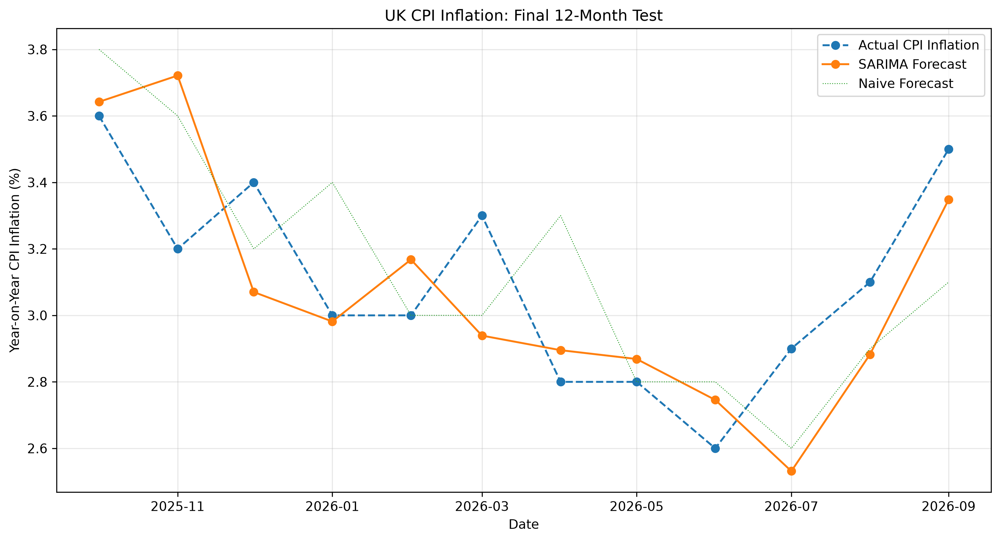
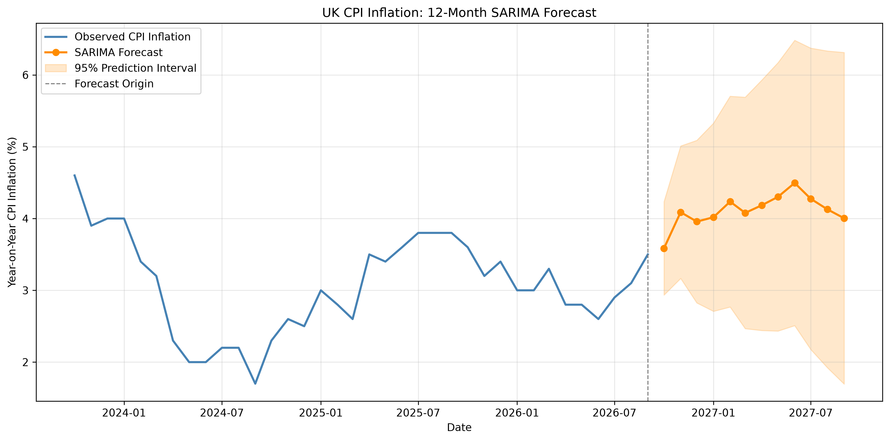

# UK Inflation Forecasting

A time-series forecasting project using Seasonal Autoregressive Integrated Moving Average (SARIMA) models to predict UK year-on-year Consumer Price Index (CPI) inflation.

## About

This project began as an attempt to model UK inflation using historical inflation data alone. As an international student studying in the UK, understanding how inflation might evolve is useful for anticipating changes in living expenses and making more informed financial decisions.

The objective is to investigate whether a univariate SARIMA model can forecast UK CPI inflation more accurately than simple benchmark methods, while examining the statistical limitations of the resulting model.

## Methodology

### 1. Data Preparation

The dataset contains monthly observations of UK year-on-year CPI inflation, expressed as percentage changes relative to the corresponding month in the previous year.

To avoid look-ahead bias during model selection, the dataset is divided chronologically into three samples:

- **Training:** All observations excluding the final 36 months, used for stationarity analysis, model fitting and initial specification selection.
- **Validation:** The subsequent 24 months, used to compare candidate models through expanding-window forecasting.
- **Testing:** The final 12 months, reserved for evaluating the selected model.

### 2. Stationarity and Autocorrelation Analysis

The Augmented Dickey–Fuller (ADF) test is applied to the original inflation series and its first differences to investigate the presence of a unit root.

Autocorrelation Function (ACF) and Partial Autocorrelation Function (PACF) plots are also examined to identify potential autoregressive, moving-average and seasonal relationships.

These diagnostics inform the specification of candidate SARIMA models.

### 3. SARIMA Model Selection

The project considers models of the form:

$$
\text{SARIMA}(p,d,q)(P,D,Q)_{12}
$$

where \(p,d,q\) describe the non-seasonal autoregressive, differencing and moving-average components, while \(P,D,Q\) describe their seasonal counterparts.

Candidate models are estimated using maximum likelihood through `statsmodels`.

The Bayesian Information Criterion (BIC) is used to rank converged specifications, balancing model fit against the number of estimated parameters.

The five lowest-BIC candidates are shortlisted for further evaluation.

### 4. Expanding-Window Validation

Each shortlisted specification is evaluated using an expanding-window, one-step-ahead forecasting procedure over the 24-month validation period.

At each forecast origin, the model is re-estimated using all observations available up to that point, before forecasting the following month's inflation rate.

Forecast performance is measured using:

**Root Mean Squared Error (RMSE)**

$$
RMSE=\sqrt{\frac{1}{n}\sum_{t=1}^{n}(y_t-\hat y_t)^2}
$$

**Mean Absolute Error (MAE)**

$$
MAE=\frac{1}{n}\sum_{t=1}^{n}|y_t-\hat y_t|
$$

Candidate performance is compared against two benchmarks:

- **Naive forecast:** The next month's inflation rate is predicted to equal the previous month's rate.
- **Seasonal naive forecast:** The next month's inflation rate is predicted to equal the rate observed 12 months earlier.

The lowest validation RMSE is considered alongside model complexity, BIC and residual diagnostics when selecting the final specification.

### 5. Residual Diagnostics

The two leading candidate specifications were subjected to additional residual analysis.

The following diagnostics were implemented:

- **Ljung–Box test:** Investigates whether the fitted model's residuals exhibit remaining serial correlation.
- **ARCH-LM test:** Investigates whether squared residuals exhibit serial dependence, indicating potential conditional heteroskedasticity.
- **Residual ACF:** Visualises autocorrelation across different lag lengths.
- **Residual time-series plots:** Examines residual magnitude and stability over time.

Both finalist models exhibited significant residual autocorrelation and ARCH effects, suggesting that the SARIMA framework does not fully capture the dynamics of inflation shocks.

These findings are retained as limitations of the model rather than disregarded in favour of forecasting performance alone.

## Model Selection and Results

The final selected specification is:

$$
\boxed{\text{SARIMA}(1,1,1)(0,0,1)_{12}}
$$

Although SARIMA(1,1,2)(0,0,1)₁₂ achieved a marginally lower validation RMSE, the simpler model was preferred because it delivered almost identical forecasting accuracy with fewer parameters and a lower training BIC.

### Validation Results

| Model | RMSE | MAE |
|---|---:|---:|
| SARIMA(1,1,1)(0,0,1)₁₂ | 0.3051 | 0.2262 |
| Naive | 0.5842 | 0.3708 |
| Seasonal naive | 4.4631 | 3.7375 |

### Final Test Results

After selecting the specification, the model was evaluated over the previously untouched 12-month test period using expanding-window, one-step-ahead forecasts.

| Model | RMSE | MAE |
|---|---:|---:|
| **SARIMA(1,1,1)(0,0,1)₁₂** | **0.2553** | **0.2074** |
| Naive | 0.2986 | 0.2583 |
| Seasonal naive | 0.7433 | 0.6583 |

All forecast errors are measured in percentage points of year-on-year CPI inflation.

The selected SARIMA model achieved a **14.5% reduction in test RMSE** and a **19.7% reduction in test MAE** relative to the naive benchmark.

These results provide preliminary evidence that the selected specification can outperform simple persistence-based forecasts. However, the relatively short test period limits the strength of conclusions about longer-term forecasting performance.

### Final Test Forecasts



## Forward Forecasting

Following model selection and testing, the selected SARIMA specification is re-estimated using the full available dataset.

The fitted model is then used to generate forecasts of UK year-on-year CPI inflation for the following 12 months, together with model-based 95% prediction intervals.



The prediction intervals widen as the forecast horizon increases, reflecting greater uncertainty over longer horizons.

However, the intervals rely on assumptions about the model's innovation process. In particular, the significant ARCH effects identified during residual analysis suggest that constant-variance prediction intervals may not be fully calibrated.

The forecasts should therefore be interpreted as conditional statistical projections rather than precise predictions of future inflation.

## Project Structure

```text
UK-Inflation-Forecasting/
├── data/
│   └── ukcpi.xls
├── src/
│   ├── __init__.py
│   ├── data.py
│   ├── models.py
│   ├── diagnostics.py
│   └── backtesting.py
├── scripts/
│   ├── __init__.py
│   ├── analysis.py
│   ├── final_test.py
│   └── generate_forecast.py
├── figures/
├── results/
├── requirements.txt
└── README.md
```

### Source Modules

| Module | Description |
|---|---|
| `data.py` | Data loading, date indexing and validation |
| `models.py` | SARIMA estimation, BIC-based specification search and forecasting |
| `diagnostics.py` | Stationarity tests, residual autocorrelation and ARCH diagnostics |
| `backtesting.py` | Expanding-window forecasting, benchmark models and error metrics |

### Analysis Scripts

| Script | Description |
|---|---|
| `analysis.py` | Exploratory analysis, candidate selection, validation and residual diagnostics |
| `final_test.py` | Out-of-sample evaluation of the selected model |
| `generate_forecast.py` | Full-sample estimation and forward forecasting with prediction intervals |

## Running the Project

Clone the repository and navigate to its root directory.

Install the required dependencies:

```bash
python3 -m pip install -r requirements.txt
```

Run the model-selection and validation pipeline:

```bash
python3 -m scripts.analysis
```

Run the final test:

```bash
python3 -m scripts.final_test
```

Generate the forward-looking inflation forecast:

```bash
python3 -m scripts.generate_forecast
```

The scripts save numerical results to `results/` and visualisations to `figures/`.

## Limitations

Several limitations should be considered when interpreting the results.

**1. Univariate modelling**

The model relies exclusively on historical CPI inflation. It does not incorporate potentially relevant economic variables such as energy prices, wage growth, exchange rates or monetary policy.

**2. Residual autocorrelation**

Ljung–Box tests indicate statistically significant residual autocorrelation, suggesting that the selected SARIMA specification does not fully capture the conditional mean dynamics of inflation.

**3. Conditional heteroskedasticity**

ARCH-LM tests identify substantial dependence in squared residuals. Consequently, the model's constant-variance assumption may be inappropriate during periods of heightened economic volatility.

**4. Limited test observations**

The final test contains only 12 monthly observations. Performance over this period may not generalise to different inflation regimes.

**5. Prediction interval calibration**

The 95% prediction intervals are derived from the fitted SARIMA model. Their empirical coverage has not yet been independently evaluated.

**6. Forecast horizon**

The validation and final testing procedures assess one-step-ahead forecasts, whereas the forward-looking projection extends to 12 months. Multi-step forecasting accuracy has not yet been evaluated out of sample.

## Potential Extensions

Future developments could include:

- Evaluating prediction interval coverage and probabilistic forecast accuracy.
- Comparing forecasting performance across multiple horizons.
- Investigating SARIMA–GARCH models to account for conditional heteroskedasticity.
- Testing for structural breaks and changes in inflation dynamics.
- Incorporating macroeconomic explanatory variables through multivariate forecasting models.
- Comparing SARIMA against alternative statistical and machine-learning forecasting methods.

## Technologies

- Python
- pandas and NumPy
- statsmodels
- SciPy
- Matplotlib
